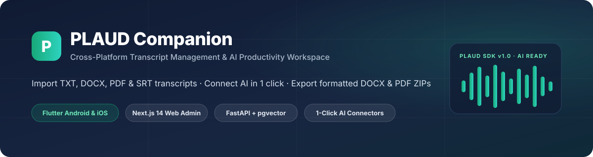
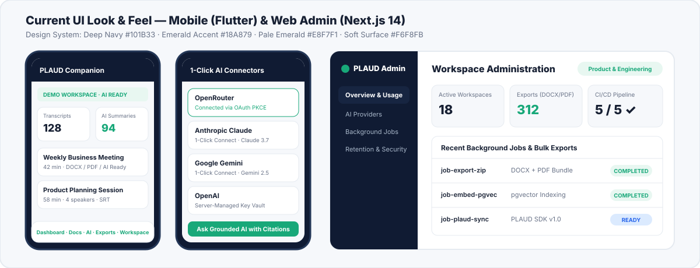
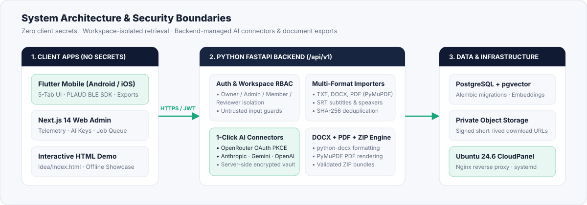

<p align="center">
  
</p>

<p align="center">
  <a href="https://github.com/iqbalmbadhan/plaud-companion/actions/workflows/ci-pipeline.yml">
    
  </a>
  
  
  
  
</p>

# PLAUD Companion

**PLAUD Companion** is a production-oriented, cross-platform transcript management and AI productivity workspace for individuals and teams. Import transcripts from PLAUD devices (`TXT`, `DOCX`, `PDF`, `SRT`), organize them across isolated workspaces, connect AI providers with **1-Click AI Connectors** (no manual API key juggling for non-technical users), and export formatted **DOCX**, **PDF**, or bulk **ZIP** bundles.

---

## Key Capabilities

- **Multi-Format Transcript Import**: Parse and deduplicate `TXT`, `DOCX`, `PDF` (via PyMuPDF), and `SRT` subtitle/speaker files with workspace-scoped isolation.
- **1-Click AI Connectors**: Non-technical users can connect **OpenRouter** (OAuth PKCE), **Anthropic Claude**, **Google Gemini**, or **OpenAI** directly from the app; provider secrets stay strictly on the FastAPI backend.
- **DOCX, PDF & Bulk ZIP Export**: Generate styled Word (`.docx`) and `.pdf` documents individually or packaged in a validated `.zip` archive.
- **5-Tab Responsive Mobile App (Flutter)**: Designed in Deep Navy (`#101B33`) and Emerald (`#18A879`) with Dashboard, Transcripts, AI Assistant, Bulk Exports, and Workspace (including **PLAUD Hardware & SDK v1.0** sync card).
- **Web Admin Console (Next.js 14)**: Manage workspaces, AI provider status, background jobs, and data retention policies.
- **Automated Multi-Platform CI/CD**: GitHub Actions builds and verifies Backend FastAPI tests, Next.js Web Admin, Flutter tests/analysis, **Android APK**, and **iOS Runner**.

---

## UI Look & Feel

<p align="center">
  
</p>

> **Try the Interactive HTML Demos:**
> - [`Idea/index.html`](Idea/index.html) — Responsive Web & Workspace UI Demo
> - [`Idea/mobile-demo.html`](Idea/mobile-demo.html) — **100% Mobile App HTML Demo** (phone frame, onboarding, 5-tab bottom navigation, bottom sheets)

---

## Architecture & Security Boundaries

<p align="center">
  
</p>

1. **Zero client secrets**: API keys, database credentials, and signing secrets never live in Flutter or Next.js browser bundles.
2. **Workspace RBAC**: Owner, Admin, Member, and Reviewer permissions are enforced server-side before database retrieval, vector search, or export download.
3. **Untrusted input isolation**: Transcript bodies, filenames, and PDFs are treated as untrusted data and never allowed to override system instructions.

---

## Repository Structure

```text
plaud-companion/
├── .github/workflows/
│   └── ci-pipeline.yml         # FastAPI tests, Next.js build, Flutter tests, Android APK & iOS Runner
├── backend/                    # Python FastAPI API, Alembic migrations, importers, AI connectors, DOCX/PDF/ZIP exports
├── mobile/                     # Flutter cross-platform app (Android & iOS)
├── web/                        # Next.js 14 + TypeScript Admin Web Console
├── deploy/cloudpanel/          # Ubuntu 24.6 CloudPanel systemd, Nginx & deploy script
├── Idea/
│   ├── index.html              # Updated interactive HTML UI demo (current look & feel)
│   └── plaud_companion_prototype-1.html
├── Docs/
│   ├── assets/                 # README SVG graphics
│   ├── CLOUDPANEL_DEPLOYMENT.md
│   ├── ARCHITECTURE.md
│   ├── AI.md
│   ├── EXPORTS.md
│   ├── IMPORTS.md
│   ├── UX.md
│   └── ...
├── .env.example
├── docker-compose.yml
├── AGENTS.md
└── README.md
```

---

## Quick Start

### 1. Download Mobile & Web Builds from GitHub Actions
Open the latest passing run in [**GitHub Actions**](https://github.com/iqbalmbadhan/plaud-companion/actions) and download:
- `plaud-companion-android-apk` — installable Android `.apk`
- `plaud-companion-ios-build` — unsigned iOS `Runner.app`
- `plaud-companion-web-build` — Next.js production `.next` bundle

### 2. Local Backend (FastAPI)
```bash
cd backend
python -m venv .venv
# Windows: .venv\Scripts\activate | Linux/macOS: source .venv/bin/activate
pip install -r requirements.txt
pytest
uvicorn app.main:app --reload
```

### 3. Deploy to Ubuntu 24.6 CloudPanel VPS
See [`Docs/CLOUDPANEL_DEPLOYMENT.md`](Docs/CLOUDPANEL_DEPLOYMENT.md) and [`deploy/cloudpanel/deploy-cloudpanel.sh`](deploy/cloudpanel/deploy-cloudpanel.sh) for step-by-step systemd + Nginx setup.

---

## Documentation Map

- [`AGENTS.md`](AGENTS.md) — engineering rules and definition of done.
- [`Docs/PRODUCT_REQUIREMENTS.md`](Docs/PRODUCT_REQUIREMENTS.md) — product scope and requirements.
- [`Docs/ARCHITECTURE.md`](Docs/ARCHITECTURE.md) — system architecture and boundaries.
- [`Docs/DATABASE.md`](Docs/DATABASE.md) — data model and isolation rules.
- [`Docs/API.md`](Docs/API.md) — API conventions and endpoint contract.
- [`Docs/UX.md`](Docs/UX.md) — design tokens (`#101B33`, `#18A879`, `#F6F8FB`) and user journeys.
- [`Docs/AI.md`](Docs/AI.md) — 1-Click AI connectors, OpenRouter/Anthropic/Gemini/OpenAI adapters, and retrieval safety.
- [`Docs/IMPORTS.md`](Docs/IMPORTS.md) — TXT/DOCX/PDF/SRT import and deduplication.
- [`Docs/EXPORTS.md`](Docs/EXPORTS.md) — DOCX, PDF, and ZIP export behavior.
- [`Docs/CLOUDPANEL_DEPLOYMENT.md`](Docs/CLOUDPANEL_DEPLOYMENT.md) — Ubuntu 24.6 CloudPanel VPS hosting guide.
- [`Docs/SECURITY_PRIVACY.md`](Docs/SECURITY_PRIVACY.md) — security and privacy requirements.
- [`Docs/TESTING.md`](Docs/TESTING.md) — test strategy and acceptance criteria.
- [`Docs/DECISIONS.md`](Docs/DECISIONS.md) — architecture decisions (`DEC-001` through `DEC-003`).
